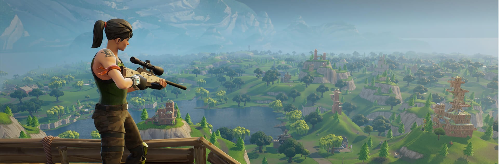
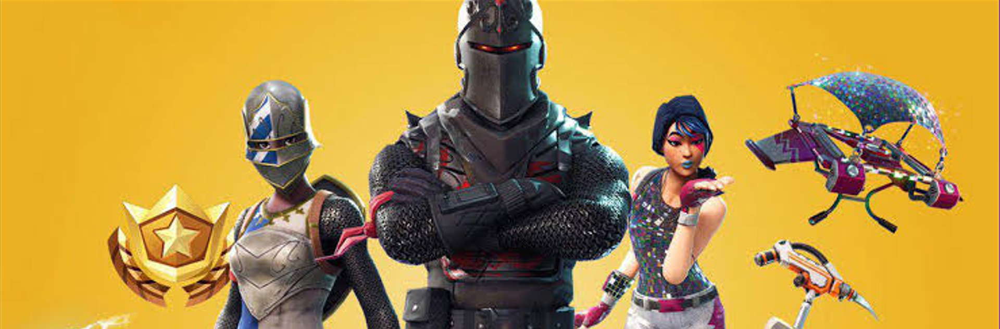
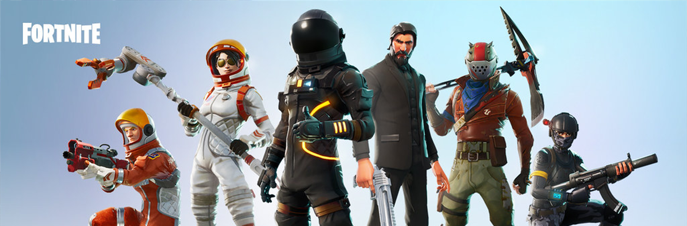
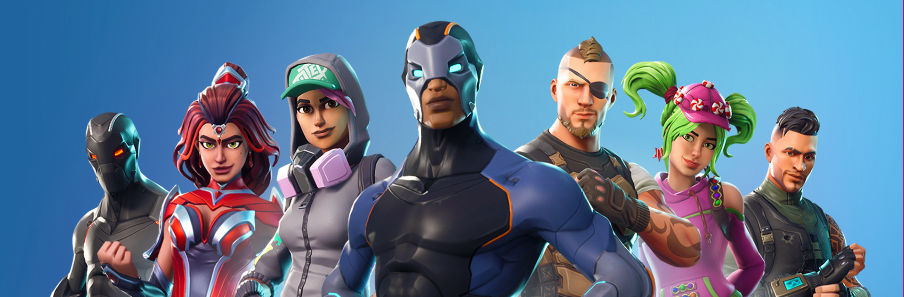
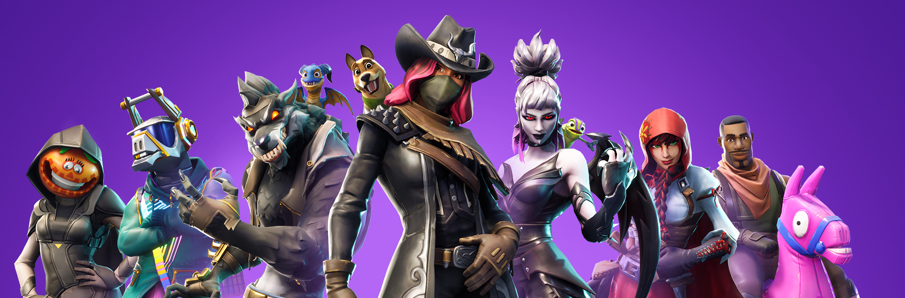
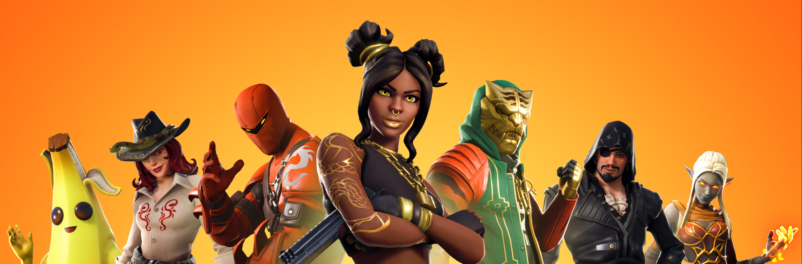
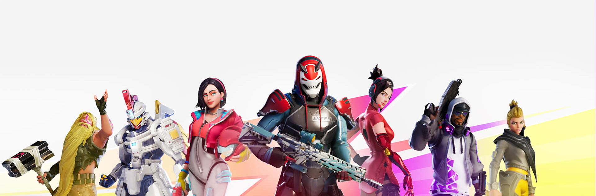
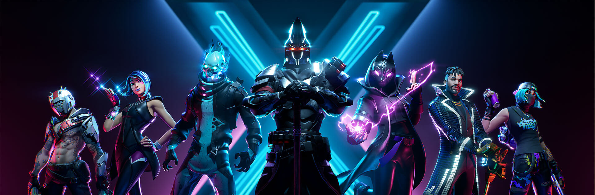
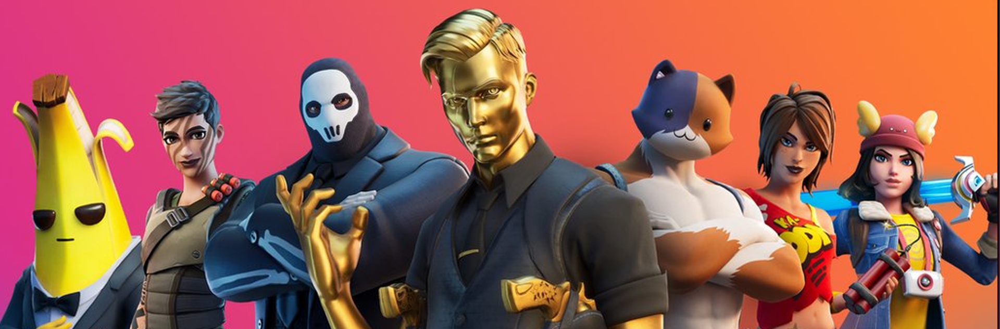

## English

# ⚠️ Important Warning / Security Notice

I collected, restored, and tested these legacy Fortnite builds out of passion for the game's "Prime" era[cite: 1, 2].

> **WARNING:** These files were originally obtained from third-party sources and contained multiple Trojans[cite: 1, 2]. I performed an extensive cleanup on every build included in this repository to remove infected files[cite: 1, 2]. However, **no cleaned build can be guaranteed 100% safe.**[cite: 1, 2]

### 🔧 Restoration & Cleanup Process
To make these builds usable, I spent 3+ hours per version manually analyzing every folder and replacing modified/infected core files (such as `Shipping.exe`, Anti-Cheat tools, and compromised DLLs) with clean, official game files I owned. Each build was then thoroughly tested to ensure stability without crashing[cite: 1].

### 🛡️ Precaution & Context
During my own testing, I picked up three Trojans and had to reinstall Windows 11 twice in two months[cite: 1, 2]. Therefore, please treat this repository as an experimental archive rather than a completely safe source[cite: 1, 2].

### 💻 Execution Guidelines
To protect your main machine, **NEVER run these builds directly on your host operating system**[cite: 1, 2].
* Run them strictly inside a **Virtual Machine (VM)**[cite: 1, 2].
* Minimum recommended VM settings[cite: 1, 2]:
  * **RAM:** 12 GB minimum[cite: 1, 2]
  * **Video Memory (VRAM):** 128 MB minimum[cite: 1, 2]


> [!NOTE]
> **Why use a Virtual Machine (VM)?**
> Due to GPU performance limitations, the game will likely not be playable smoothly inside a Virtual Machine. 
> 
> The main purpose of running it inside a VM is to **safely test launching the build** and monitor any system behavior (file changes, background processes, network activity) without risking your primary operating system.
*Use these files entirely at your own risk.*[cite: 1, 2]

# ------------------------------------------

## Downloads

### Pre season

<div style="width: 100%; height: 260px; overflow: hidden;">
  
</div>

| Build | Date | Cleaned Status | Notes / Details | Download links |
| :--- | :---: | :---: | :--- | :--- |
| **1.7.2-CL-3700114** | 17-10-17 | 🟢 Yes | Voice chat activation & Teammate spectating toggle | [**Download**(https://archive.org/details/fortnite_1.7.2)] |


### Season 2

<div style="width: 100%; height: 260px; overflow: hidden;">
  
</div>

| Build | Date | Cleaned Status | Notes / Details | Download links |
| :--- | :---: | :---: | :--- | :--- |
| **2.3.0-CL-3847564** | 27-06-18 | 🟠 In Progress | Added Auto Run & Added setting to disable aim assist consoles | **soon** |

### Season 3

<div style="width: 100%; height: 260px; overflow: hidden;">
  
</div>

| Build | Date | Cleaned Status | Notes / Details | Download links |
| :--- | :---: | :---: | :--- | :--- |
| **3.5-CL-4000805** | 12-04-18 | 🟠 In Progress | Replay Layout & Port-a-Fort & Meteorite visible | **soon** |

### Season 4

<div style="width: 100%; height: 260px; overflow: hidden;">
  
</div>

| Build | Date | Cleaned Status | Notes / Details | Download links |
| :--- | :---: | :---: | :--- | :--- |
| **4.5-CL-4131557** | 27-06-18 | 🟢 Yes | The Rocket Launch Event & New Mode Playground | **soon** |

### Season 6

<div style="width: 100%; height: 260px; overflow: hidden;">
  
</div>

| Build | Date | Cleaned Status | Notes / Details | Download links |
| :--- | :---: | :---: | :--- | :--- |
| **6.21-CL-4465229** | 01-11-18 | 🟢 Yes | Butterfly event & Gameplay Adjustments | [**Download**](https://archive.org/details/fortnite_6.21) |

### Season 8

<div style="width: 100%; height: 260px; overflow: hidden;">
  
</div>

| Build | Date | Cleaned Status | Notes / Details | Download links |
| :--- | :---: | :---: | :--- | :--- |
| **8.51-CL-6106603** | 02-05-19 | 🟢 Yes | Shadow Bomb update & The Unvaulting prep | [**Download**](https://archive.org/details/fortnite_8.51) |

### Season 9

<div style="width: 100%; height: 260px; overflow: hidden;">
  
</div>

| Build | Date | Cleaned Status | Notes / Details | Download links |
| :--- | :---: | :---: | :--- | :--- |
| **9.10-CL-6639283** | 22-05-19 | 🟢 Yes | Hot Spots & Downtown Drop Crossover | **soon** |

### Season X

<div style="width: 100%; height: 260px; overflow: hidden;">
  
</div>

| Build | Date | Cleaned Status | Notes / Details | Download links |
| :--- | :---: | :---: | :--- | :--- |
| **10.40-CL-9380822** | 25-09-19 | 🟢 Yes | The End Event & Starry Suburbs Rift Zone | [**Download**](https://archive.org/details/fortnite_10.40) |

### Season 12

<div style="width: 100%; height: 260px; overflow: hidden;">
  
</div>

| Build | Date | Cleaned Status | Notes / Details | Download links |
| :--- | :---: | :---: | :--- | :--- |
| **12.41-CL-12905909** | 21-04-20 | 🔴 No | Travis Scott "Astronomical" Event & Gameplay Fixes | **N/A** |

### 🔒 File Integrity & Verification (SHA-256)

Before launching any downloaded archive, you can verify its file integrity by checking its **SHA-256 hash**. This ensures that the file was not altered or corrupted during download.

#### How to check the hash on Windows:
Open PowerShell in the folder where your downloaded `.zip` or `.rar` file is located and run:
```powershell
Get-FileHash "filename.zip" -Algorithm SHA256
```

---

#### Hashes List:

| Season | Build Version | Details / Notes | Filename | SHA-256 Hash |
| :--- | :--- | :--- | :--- | :--- |
| **Pre season** | `1.7.2-CL-3700114` | Voice chat activation & Teammate spectating toggle | `Fortnite_Season1.zip` | *``* |
| **Season 2** | `2.3.0-CL-3847564` | Added Auto Run & Added setting to disable aim assist consoles | `Fortnite_Season2.zip` | *``* |
| **Season 3** | `3.5-CL-4000805` | Replay Layout & Port-a-Fort & Meteorite visible | `Fortnite_Season3.zip` | *``* |
| **Season 4** | `4.5-CL-4131517` | The Rocket Launch Event & New Mode Playground | `Fortnite_Season4.zip` | *``* |
| **Season 6** | `6.21-CL-4465228` | Butterfly event & Gameplay Adjustments | `Fortnite_Season6.zip` | *``* |
| **Season 8** | `8.51-CL-6169660` | Shadow Bomb update & The Unvaulting prep | `Fortnite_Season8.zip` | *``* |
| **Season 9** | `9.10-CL-6628263` | Hot Spots & Downtown Drop Crossover | `Fortnite_Season9.zip` | *``* |
| **Season X** | `10.40-CL-8380823` | The End Event & Starry Suburbs Rift Zone | `Fortnite_SeasonX.zip` | *``* |
| **Season 12** | *`12.41-CL-12905909`* | Travis Scott Event & Gameplay Fixes | `Fortnite_Season12.zip` | *``* |
